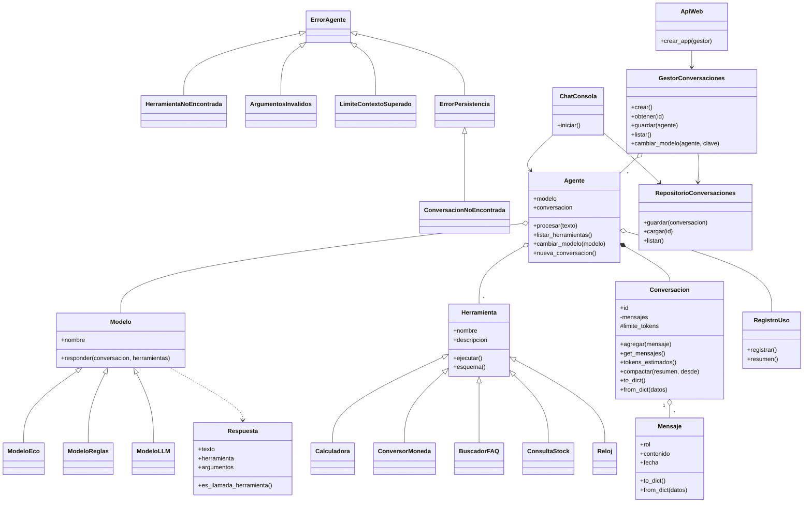

# NEXO: asistente de TechNova

Esqueleto de un agente de IA con herramientas, construido con Programación Orientada a Objetos y arquitectura por capas.

**Módulo 5073 · Programación de Inteligencia Artificial** (Especialización en IA y Big Data)
Tema 1 · Python para IA (bloque de POO) · UD1 / RA1

## Índice

- [NEXO: asistente de TechNova](#nexo-asistente-de-technova)
  - [Índice](#índice)
  - [1. Descripción](#1-descripción)
  - [2. Requisitos y ejecución](#2-requisitos-y-ejecución)
    - [Tests](#tests)
  - [3. Nivel alcanzado](#3-nivel-alcanzado)
    - [Retos del Nivel 3](#retos-del-nivel-3)
  - [4. Comandos del chat](#4-comandos-del-chat)
  - [5. Arquitectura](#5-arquitectura)
  - [6. Diagrama de clases](#6-diagrama-de-clases)
  - [7. Decisiones de diseño](#7-decisiones-de-diseño)
  - [8. Uso de asistentes de IA](#8-uso-de-asistentes-de-ia)
  - [9. Preguntas de reflexión](#9-preguntas-de-reflexión)
  - [10. Ampliación: interfaz web](#10-ampliación-interfaz-web)
    - [Ejecución](#ejecución)
    - [Qué incluye](#qué-incluye)
    - [Streaming](#streaming)
    - [Seguridad y errores](#seguridad-y-errores)

---

## 1. Descripción

NEXO es un agente conversacional por capas con herramientas locales, memoria persistente y una interfaz web visual. La web puede usar `ModeloReglas` sin conexión o un LLM compatible con Chat Completions si se configura una clave privada en el servidor.

En despliegue web, `main_web.py` sirve la interfaz React y la API; el usuario interactúa desde el navegador, sin abrir el chat de consola.

Para una explicación rápida del flujo, la arquitectura y las limitaciones, consulta la [guía breve de funcionamiento](GUIA_FUNCIONAMIENTO.md).

Herramientas disponibles:

| Herramienta        | Función                                          |
| ------------------ | ------------------------------------------------ |
| `calculadora`      | Suma, resta, multiplica y divide dos números     |
| `conversor_moneda` | Convierte entre EUR, USD, GBP y JPY              |
| `buscador_faq`     | Responde preguntas frecuentes de TechNova        |
| `consulta_stock`   | Consulta las unidades disponibles de un producto |
| `reloj`            | Indica la fecha y la hora actuales               |

## 2. Requisitos y ejecución

- Python 3.10 o superior.
- Las dependencias de `requirements.txt` (`fastapi`, `uvicorn`, `python-dotenv`, `httpx`, `tenacity`). Hacen falta también para la consola, porque `dominio/modelos.py` importa `httpx`, `tenacity` y `dotenv`.
- Node.js solo si se quiere modificar o volver a compilar el frontend (el `dist/` ya viene compilado).

```bash
cd nexo
python -m venv .venv
source .venv/bin/activate        # Windows: .venv\Scripts\activate
pip install -r requirements.txt
python main.py                   # consola
python main_web.py               # interfaz web en http://127.0.0.1:8000
```

Para usar el modelo remoto (opcional), copia la plantilla de configuración y rellena la clave; ver la [sección 10](#10-ampliación-interfaz-web).

Los datos se generan automáticamente junto a `main.py`:

```
datos/
├── conversaciones/    un fichero .json por conversación guardada
└── uso.csv            uso de herramientas y tokens/coste real del LLM
```

`uso.csv` incluye `timestamp,question,output_tokens,cost` para las llamadas LLM y columnas separadas para el uso de herramientas. Los CSV antiguos de herramientas se migran al nuevo formato al iniciar.

### Tests

```bash
python -m unittest discover -s tests -t .
```

Para ejecutar **todos los tests** (Python y frontend) de una vez y ver un resumen: `python ejecutar_tests.py` (opciones y estados en `docs/PRUEBAS.md`). También se pueden ejecutar con `pytest`. Instala `requirements-dev.txt` para ejecutar todas las pruebas, incluidas las de la API web.

Hay 120 funciones `test_*` en Python (recuento estático de `tests/`). Los ficheros `test_api.py` (19) y `test_modelo_llm.py` (11) necesitan además FastAPI; sin ellos pasan 90 tests de Python. El frontend tiene unos 35 casos de vitest (`npm test` en `frontend/`). Para comprobar el proveedor LLM real con tu `.env` está `python probar_llm.py` (`--modelos` lista los modelos que admite tu clave).

## 3. Nivel alcanzado

| Nivel                 | Contenido                                                                      | Estado     |
| --------------------- | ------------------------------------------------------------------------------ | ---------- |
| 1. Agente básico      | Dominio completo, herramientas, `ModeloEco`, `ModeloReglas`, agente y chat     | Completado |
| 2. Agente con memoria | Conversaciones en JSON, registro de uso en CSV y comandos del chat             | Completado |
| 3. Agente pro         | Retos 1–6, incluyendo LLM opcional, validación, reintentos, streaming y costes | Completado |

### Retos del Nivel 3

| Reto                                       | Implementación                                                                                              |
| ------------------------------------------ | ----------------------------------------------------------------------------------------------------------- |
| 1. Herramientas nuevas sin tocar el agente | `ConsultaStock` y `Reloj`, añadidas únicamente en el punto de composición                                   |
| 2. Modelo LLM real                         | `ModeloLLM` opcional con clave desde `.env`, validación, reintentos 429/5xx, SSE y registro de tokens/coste |
| 3. Descripción en JSON Schema              | `Herramienta.esquema()`, visible con el comando `/esquemas`                                                 |
| 4. Varias herramientas en una pregunta     | Una petición puede encadenar el conversor y la calculadora                                                  |
| 5. Tests                                   | Pruebas de dominio, API, persistencia, validación, reintentos y streaming                                   |
| 6. Resumen automático                      | Al superar el 80 % del límite de tokens, los mensajes antiguos se sustituyen por un mensaje `[resumen]`     |

## 4. Comandos del chat

| Comando                          | Acción                                                 |
| -------------------------------- | ------------------------------------------------------ |
| *(texto normal)*                 | Envía el mensaje a NEXO                                |
| `/herramientas`                  | Lista las herramientas disponibles                     |
| `/esquemas`                      | Muestra las herramientas en formato JSON Schema        |
| `/modelo eco` · `/modelo reglas` | Cambia de modelo en caliente                           |
| `/historial`                     | Muestra los mensajes y los tokens estimados            |
| `/guardar`                       | Guarda la conversación en disco                        |
| `/cargar <id>`                   | Carga una conversación guardada                        |
| `/lista`                         | Lista las conversaciones guardadas                     |
| `/nueva`                         | Empieza una conversación nueva                         |
| `/limpiar`                       | Guarda la actual y empieza de cero (historial intacto) |
| `/stats`                         | Resumen de uso de las herramientas                     |
| `/ayuda`                         | Muestra la lista de comandos                           |
| `/salir`                         | Termina el programa                                    |

Ejemplos de frases que entiende `ModeloReglas`:

| Para activar            | Ejemplo                                          |
| ----------------------- | ------------------------------------------------ |
| Calculadora             | `si compro 3 * 79.9 cuánto pago?`                |
| Conversor               | `cuánto son 250 USD en euros`                    |
| Conversor + calculadora | `convierte 100 USD a euros y multiplícalo por 3` |
| Preguntas frecuentes    | `cuánto tarda el envío?`                         |
| Stock                   | `cuántas unidades de teclado mecánico quedan?`   |
| Fecha y hora            | `qué hora es?`                                   |

## 5. Arquitectura

El proyecto se organiza en cuatro capas. Cada capa solo depende de las inferiores.

| Capa         | Carpeta         | Responsabilidad                                                                     |
| ------------ | --------------- | ----------------------------------------------------------------------------------- |
| Presentación | `presentacion/` | Lee la entrada, llama al agente y muestra el resultado. No toma decisiones.         |
| Servicios    | `servicios/`    | Bucle del agente: pregunta, modelo, herramienta, respuesta.                         |
| Dominio      | `dominio/`      | Las piezas del agente: mensajes, conversación, herramientas, modelos y excepciones. |
| Persistencia | `persistencia/` | Conversaciones en JSON y registro de uso en CSV.                                    |

Reglas de arquitectura:

1. En `dominio/` y `servicios/` no hay `print()` ni `input()`: los métodos devuelven valores.
2. La capa de presentación no decide nada de negocio.
3. Las piezas se conectan en un único lugar: `main.py`.

Estructura de carpetas:

```
nexo/
├── main.py                       punto de entrada de la consola
├── main_web.py                   punto de entrada web (API + frontend)
├── probar_llm.py                 prueba el proveedor LLM con tu .env (solo biblioteca estándar)
├── ejecutar_tests.py             ejecuta todos los tests y muestra un resumen
├── .env.example                  plantilla de configuración del LLM (copiar a .env)
├── requirements.txt · requirements-dev.txt · pytest.ini
├── GUIA_FUNCIONAMIENTO.md · CAMBIOS.md
├── dominio/
│   ├── excepciones.py
│   ├── mensaje.py            Mensaje y Conversacion
│   ├── herramientas.py       Herramienta y sus hijas
│   ├── modelos.py            Modelo, Respuesta, ModeloEco, ModeloReglas, ModeloLLM
│   ├── sorpresas.py          respuesta fija de la sorpresa «Fernando Alonso»
│   └── texto.py              utilidades de normalización de texto
├── servicios/
│   ├── agente.py             Agente
│   └── gestor_conversaciones.py   varias conversaciones a la vez (web)
├── persistencia/
│   ├── repositorio_conversaciones.py
│   └── registro_uso.py
├── presentacion/
│   ├── chat_consola.py
│   ├── api.py                API HTTP (FastAPI)
│   └── esquemas_api.py       validación de las peticiones
├── frontend/                 React + Vite + TypeScript
│   ├── src/                  componentes, hook useChat, api/, formato.ts (Markdown), huevos.ts, voz.ts...
│   ├── src/estilos/          hojas CSS; responsive.css reúne las media queries
│   ├── public/sorpresas/     imagen de la sorpresa
│   └── dist/                 interfaz ya compilada (la sirve la API)
├── datos/                    se genera al usar el programa (conversaciones/ y uso.csv)
├── docs/                     API, pruebas, informes, auditoría y capturas
├── tests/
└── README.md
```

## 6. Diagrama de clases



## 7. Decisiones de diseño

**Encapsulación**
- La lista de mensajes de `Conversacion` es privada y se accede mediante métodos. `get_mensajes()` devuelve una copia.
- `Mensaje` es de solo lectura: sus atributos se exponen como propiedades.

**Polimorfismo**
- El agente ejecuta siempre `self._herramientas[nombre].ejecutar(**args)`, sin `isinstance` ni cadenas de `if` por tipo de herramienta.
- Cambiar de modelo en caliente (`/modelo`) funciona porque el agente solo conoce la interfaz `Modelo`.

**Comunicación entre capas**
- Los mensajes de herramienta se guardan como `[nombre] resultado` (o `[nombre] Error: ...`), de modo que el modelo sabe qué herramienta produjo el resultado.
- Para mostrar las llamadas a herramientas sin `print()` en el servicio, el agente guarda las del último `procesar()` y la capa de presentación las lee con `llamadas_realizadas`.

**Rendimiento y robustez**
- `Conversacion` mantiene un contador de palabras incremental, por lo que `agregar()` no recorre el historial completo.
- El JSON se guarda de forma atómica (fichero temporal y `os.replace`), de modo que una interrupción nunca deja un fichero a medias.
- El chat captura todas las excepciones de `ErrorAgente` y dispone de una red de seguridad para fallos inesperados.
- El identificador de `/cargar` solo admite letras, números, `_` y `-`, para impedir salir de la carpeta de datos.

**Gestión de memoria**
- Si un mensaje supera el límite de tokens, no se añade y el chat sugiere `/nueva`.
- El resumen automático lo orquesta el `Agente`; `Conversacion.compactar()` solo sustituye mensajes. Siempre se conserva el último intercambio.

**Limitaciones conocidas**
- `ModeloReglas` detecta patrones simples (por ejemplo, «3 x 4» o «250 USD») y no entiende lenguaje natural complejo.
- El resumen automático es extractivo: conserva el inicio de cada pregunta antigua, no interpreta su contenido.

## 8. Uso de asistentes de IA

Se ha utilizado **Claude** (Anthropic) como asistente, tanto en el chat como con herramientas de ejecución de código. El código del proyecto ha sido generado y revisado con esa ayuda a partir de las peticiones que se listan aquí; cada miembro debe poder explicar cualquier clase.

**Qué se le solicitó**
- Generar el esqueleto del proyecto siguiendo el enunciado: las cuatro capas, herramientas, modelos, agente, persistencia y chat.
- Mejorar y optimizar el código, y añadir retos del Nivel 3.
- Escribir los tests y la guía de ejecución.
- Redactar y limpiar el README (quitar emoticonos y darle un tono profesional), completar secciones que faltaban y preparar respuestas a las preguntas de reflexión.
- Integrar un modelo LLM real con streaming, validación de la petición, reintentos con `tenacity` y registro de tokens y coste en `uso.csv`.
- Construir y rediseñar la interfaz web (React + TypeScript): estética cyberpunk, logo, esfera animada del núcleo y paneles de configuración y estadísticas.
- Auditar el proyecto, buscar errores y proponer mejoras, y comprobar su cumplimiento con el enunciado y la rúbrica.
- Preparar una presentación breve y una guía para una demostración en directo.
- Añadir sorpresas visuales. La que queda es el nombre «Fernando Alonso» (la del «67» se eliminó después). La IA no dibuja personas reales, así que la animación usa un piloto genérico original.
- Adaptar `ModeloLLM` a Groq y otros proveedores compatibles con la API de OpenAI, cambiar la paleta a azul y violeta, resolver el Markdown de las respuestas y hacer la interfaz adaptable a distintos tamaños de pantalla.

**Qué se ha cambiado o comprobado**
- Errores encontrados en la revisión y corregidos:
  - Al cambiar de conversación mientras NEXO respondía, la respuesta aparecía en la conversación equivocada.
  - El lector de streaming no admitía saltos de línea `\r\n`.
  - Los parámetros inválidos del LLM devolvían un error 500 genérico en vez de un 422.
  - El HUD de la esfera mostraba cifras inventadas (carga del sistema aleatoria); ahora solo muestra datos reales.
  - Una nota en `requirements.txt` afirmaba que la consola no necesitaba dependencias, y no era cierto.
- Pruebas: el ejemplo de ejecución del enunciado se reprodujo sobre el agente y dio las salidas esperadas; 90 tests de Python (dominio, agente, persistencia, gestor, robustez, sorpresas y compatibilidad LLM) pasaron en el entorno de desarrollo. Además se arrancó la API y se probó la interfaz compilada con un navegador real. `test_api.py` y `test_modelo_llm.py` solo se ejecutan donde está FastAPI instalado, los tests de vitest no se han podido ejecutar en ese entorno y el `ModeloLLM` no se ha probado con un proveedor real (no había salida a internet); `probar_llm.py` sirve para comprobarlo con tu clave. [COMPLETAR: resultado de `python -m unittest discover -s tests -t .` en vuestra máquina con las dependencias instaladas.]
- Datos de ejemplo definidos en el código, que pueden ajustarse sin tocar la lógica (el equipo debe indicar cuáles ha cambiado respecto a lo propuesto):
  - Tasas de cambio en `ConversorMoneda.TASAS_A_EUR`: EUR 1, USD 0,92, GBP 1,17 y JPY 0,0062.
  - Preguntas y respuestas de la FAQ en `BuscadorFAQ.FAQ`: envíos, devoluciones, horario y formas de pago.
  - Catálogo de `ConsultaStock.STOCK`: SSD 1 TB (14), RAM DDR5 16 GB (0), tarjeta gráfica RTX 4060 (3), monitor 27 pulgadas (7) y teclado mecánico (25).
  - Textos de saludo y de respuesta en `ModeloReglas`.
  - [COMPLETAR: cuáles de estos datos o textos ha cambiado el equipo, y por qué.]
- Revisión del código por clases (cada persona debe poder explicar las suyas):

| Clase                                                                                    | Fichero                   | Revisada por        |
| ---------------------------------------------------------------------------------------- | ------------------------- | ------------------- |
| `Herramienta`, `Calculadora`, `ConversorMoneda`, `BuscadorFAQ`, `ConsultaStock`, `Reloj` | `dominio/herramientas.py` | [COMPLETAR: nombre] |
| `Mensaje`, `Conversacion`                                                                | `dominio/mensaje.py`      | [COMPLETAR: nombre] |
| `Modelo`, `ModeloEco`, `ModeloReglas`, `ModeloLLM`, `Respuesta`                          | `dominio/modelos.py`      | [COMPLETAR: nombre] |
| Jerarquía `ErrorAgente`                                                                  | `dominio/excepciones.py`  | [COMPLETAR: nombre] |
| `Agente`, `GestorConversaciones`                                                         | `servicios/`              | [COMPLETAR: nombre] |
| `RegistroUso`, `RepositorioConversaciones`                                               | `persistencia/`           | [COMPLETAR: nombre] |
| `ChatConsola`, API y esquemas                                                            | `presentacion/`           | [COMPLETAR: nombre] |
| Interfaz web (React)                                                                     | `frontend/src/`           | [COMPLETAR: nombre] |

**Decisiones de diseño entendidas y mantenidas**
- Formato `[nombre] resultado` en los mensajes de herramienta.
- El agente registra las llamadas del último `procesar()` para que la presentación las muestre sin que el servicio imprima.
- El resumen automático se orquesta en el agente y `Conversacion.compactar()` solo sustituye mensajes.

## 9. Preguntas de reflexión

**1. ¿Cómo se conecta el modelo LLM y qué capas intervienen?**

`ModeloLLM`, hija de `Modelo`, traduce los roles, envía los esquemas de `Herramienta.esquema()` y convierte texto o llamadas de herramienta en `Respuesta`. `main_web.py` solo registra este modelo si existe `LLM_API_KEY`. El agente reutiliza la misma interfaz de modelos; su flujo por pasos permite trasladar los fragmentos remotos a SSE. La presentación web no conoce la clave ni llama directamente al proveedor.

**2. ¿Por qué `get_mensajes()` devuelve una copia de la lista y no la original?**

Porque la lista es privada para proteger el historial. Si se devolviera la original, cualquiera podría hacer `get_mensajes().append(...)` o `.clear()` y alterar la conversación sin pasar por `agregar()`, saltándose el control del límite de tokens y desincronizando el contador de palabras. Con la copia, el único modo de modificar el historial son los métodos de la clase. Además, `Mensaje` es de solo lectura, por lo que tampoco se pueden alterar los mensajes contenidos en la copia.

**3. El modelo pide la herramienta, pero la ejecuta el agente. ¿Por qué funcionan así las APIs reales?**

Por seguridad y control. El modelo solo produce texto y no debe tener acceso directo al sistema. Al ejecutar la herramienta, el agente puede comprobar que existe (si no, lanza `HerramientaNoEncontrada`), validar los argumentos, limitar el número de vueltas, registrar cada uso y capturar errores. También podría pedir confirmación antes de acciones delicadas. Esto es importante porque un modelo puede equivocarse o ser manipulado mediante texto malicioso (*prompt injection*), y el agente es la barrera entre lo que el modelo pide y lo que realmente ocurre.

**4. ¿En qué se parece `BuscadorFAQ` a un sistema RAG? ¿Qué limitaciones tiene buscar por palabras en común?**

Se parece en que primero recupera información de una fuente de conocimiento (la FAQ) según la pregunta, y después la utiliza para construir la respuesta. Un RAG real recuperaría con embeddings y pasaría lo recuperado a un LLM para redactar la respuesta. Contar palabras en común tiene varias limitaciones:

- No entiende sinónimos: «¿cuándo me llega el paquete?» no comparte palabras con «envío».
- Es sensible a la forma de las palabras, las faltas de ortografía y los plurales.
- No pondera la importancia de cada palabra y puede producir empates.
- No comprende el contexto ni el significado de la frase.

Los embeddings resuelven esto porque comparan significados, no palabras literales.

**5. Si TechNova quiere el chat en una web con React, ¿qué carpetas se quedan exactamente igual?**

`dominio/`, `servicios/` y `persistencia/` permanecen idénticas, porque no contienen `print()` ni `input()` y no conocen la interfaz. Cambia `presentacion/`, que se sustituye por la interfaz en React. Como React no puede llamar directamente a Python, se necesitaría una pequeña capa de API (por ejemplo con FastAPI) que reciba los mensajes y llame a `Agente.procesar()`. También se ajustaría `main.py` para conectar las piezas con esa nueva capa.

> **Actualización:** esta respuesta se ha llevado a la práctica (sección 10). `dominio/` y `persistencia/` no han cambiado de comportamiento; `servicios/` solo ha ganado `procesar_por_pasos()` (que `procesar()` reutiliza) y el `GestorConversaciones`; `presentacion/` incorpora la API.

## 10. Ampliación: interfaz web

Interfaz de chat con estética cyberpunk (paleta de cian, azul y violeta sobre casi negro) sobre el mismo agente: **API con FastAPI** (`presentacion/api.py`) y **frontend React + Vite + TypeScript** (`frontend/`). La consola sigue funcionando igual.


> Las capturas de `docs/` (`captura-escritorio.png`, `captura-estadisticas.png`, `captura-movil.png`) son de la paleta azul/violeta actual (Chrome sin interfaz, 1920x1080 y 390x844).

### Ejecución

```bash
pip install -r requirements.txt
python main_web.py                 # http://127.0.0.1:8000
```

`frontend/dist/` (el frontend ya compilado) se sirve desde la propia API, por lo que no hace falta Node para usarlo. El `dist/` incluido se generó con esbuild; `npm run build` lo regenera con Vite. Esta es la entrada visual para desplegar NEXO; `main.py` queda como utilidad local de desarrollo. Para modificar el frontend:

```bash
cd frontend && npm install
npm run build                      # regenera dist/
npm run dev                        # http://localhost:5173 con recarga; requiere python main_web.py en marcha
npm test                           # vitest: streaming, sorpresas, formato Markdown, voz, comandos, imágenes y modelos
```

Variables de entorno del servidor: `NEXO_PUERTO` (por defecto 8000) y `NEXO_CORS` (orígenes permitidos separados por comas; por defecto `http://localhost:5173,http://127.0.0.1:5173`). Para habilitar el LLM:

```bash
cp .env.example .env            # PowerShell: Copy-Item .env.example .env
# Edita .env y establece LLM_API_KEY con tu clave; nunca la incluyas en el frontend.
python probar_llm.py            # opcional: comprueba clave, URL y modelo con una llamada real
```

`ModeloLLM` usa la API de chat completions de OpenAI y es compatible con otros proveedores que la ofrecen, como Groq. La plantilla `.env.example` trae Groq por defecto (`LLM_API_URL=https://api.groq.com/openai/v1/chat/completions`, `LLM_MODEL=openai/gpt-oss-120b`) y OpenAI como alternativa comentada. Variables que lee `ModeloLLM`:

| Variable                  | Valor en `.env.example` | Función                                                                                                                          |
| ------------------------- | ----------------------- | -------------------------------------------------------------------------------------------------------------------------------- |
| `LLM_API_KEY`             | vacío                   | Clave del proveedor. Sin ella la web solo ofrece los modelos locales                                                             |
| `LLM_API_URL`             | Groq (ver arriba)       | Endpoint de chat completions (por defecto en el código: OpenAI)                                                                  |
| `LLM_MODEL`               | `openai/gpt-oss-120b`   | Modelo del proveedor (por defecto en el código: `gpt-4o`)                                                                        |
| `LLM_MAX_TOKENS`          | `500`                   | Tope normal de tokens por respuesta (por defecto en el código, si falta: 150)                                                    |
| `LLM_MAX_TOKENS_AMPLIADO` | `1000`                  | Si la respuesta se corta en el tope normal, se continúa automáticamente hasta este total; `0` desactiva la ampliación            |
| `LLM_REASONING_EFFORT`    | `low`                   | Esfuerzo de razonamiento para modelos gpt-oss (`low`, `medium`, `high`); vacío = no se envía                                     |
| `LLM_SYSTEM`              | comentada               | Instrucción de sistema; vacío = ninguna; si no se define, se usa una instrucción por defecto (español, concisa y en texto plano) |
| `LLM_TEMPERATURE`         | `0.7`                   | Temperatura                                                                                                                      |
| `LLM_COST_PER_1K_OUTPUT`  | `0.008`                 | Tarifa didáctica en € por 1000 tokens de salida; ajústala a la del proveedor                                                     |

Los modelos gpt-oss razonan y gastan tokens pensando, de ahí `LLM_REASONING_EFFORT=low` y el tope ampliado. Los tokens de salida se leen de `usage` (o de `x_groq.usage`) y, si el proveedor no los envía en streaming, se estiman. Cuando el proveedor rechaza la petición, la API devuelve el error `error_proveedor` (502) con el código HTTP y el motivo del proveedor (clave inválida, modelo inexistente, límite...), nunca la clave. `.env` está excluido en `.gitignore`.

### Qué incluye

- **Barra lateral:** nueva conversación, historial (conversaciones guardadas en `datos/conversaciones/`), configuración, estadísticas y estado de la API.
- **Cabecera y núcleo:** modelo activo, sesión guardada (`sesión <id> · guardada`), medidor de contexto y una esfera animada (tonos cian, azul y violeta) con un panel de datos reales (modelo, contexto estimado, estado de la API, último comando). La esfera tiene tres estados (en espera, procesando y respondiendo), limita sus fotogramas y no se anima si el sistema pide reducir el movimiento. Al responder «habla»: cada sílaba del texto que llega por streaming hace latir el núcleo y lanza una onda, las comas y los puntos producen pausas, y un anillo ecualizador azul reacciona al nivel de voz (`frontend/src/voz.ts`). No hay audio: es una animación.
- **Chat:** bienvenida con ejemplos, mensajes (las respuestas se pintan con su Markdown resuelto: negrita, cursiva, listas y títulos sin asteriscos sueltos, en `frontend/src/formato.ts` y `TextoFormateado.tsx`; «Copiar» entrega texto limpio), herramientas ejecutadas con sus argumentos y errores (por ejemplo `calculadora (a=3, b=79.9, operacion='*')`), indicador de generación, copiar respuesta, avisos de error y aviso al cambiar de modelo. Los argumentos se muestran durante la sesión; al recargar solo se conserva el resultado, porque el servidor guarda `[herramienta] resultado`.
- **Configuración:** selector con ModeloReglas y ModeloEco en un grupo «Modelos locales» y ModeloLLM aparte, en «Modelo remoto · API». ModeloLLM aparece siempre: sin `LLM_API_KEY` sale desactivado con la etiqueta «NO CONFIGURADO» y el motivo; con clave se puede elegir y muestra el modelo del proveedor. Lista de herramientas leída de la API.
- **Estadísticas:** peticiones, conversaciones, tokens estimados, tokens reales/coste LLM y uso/fallos por herramienta (de `uso.csv`).
- Las conversaciones se guardan automáticamente tras cada mensaje, por lo que `/guardar` no tiene botón propio.
- **Sorpresas:** solo queda una: al escribir «Fernando Alonso» (en cualquier combinación de mayúsculas y minúsculas, solo como expresión completa) aparece un piloto genérico celebrando una victoria con el nombre bien escrito. La animación es una ilustración propia, no representa a ninguna persona real, y se define en `frontend/src/huevos.ts`, un registro fácil de ampliar. Además, el chat contesta con una foto (`frontend/public/sorpresas/fernando-alonso.jpg`, aportada por el equipo). Esa respuesta está en `dominio/sorpresas.py` (solo la conoce `ModeloReglas`), se guarda en el historial como cualquier mensaje y la consola la muestra como texto. El chat solo admite imágenes de la carpeta `/sorpresas/`. La sorpresa del «67» se eliminó: escribir 67 es un mensaje normal.
- **Adaptación a pantallas:** menús compactos para que a 1920x1080 todo quepa sin scroll de página. Las media queries están reunidas en `frontend/src/estilos/responsive.css` (se carga la última): cajón lateral en pantallas estrechas o bajas, paneles a pantalla completa en móvil y esfera más baja en alturas de 800 px o menos. Quedan copias antiguas de `@media` en otras hojas, inocuas porque `responsive.css` gana por cascada.

### Streaming

`POST /api/conversaciones/{id}/mensajes/stream` responde con *Server-Sent Events*: un evento `herramienta` por cada herramienta ejecutada, eventos `fragmento` con el texto y un `fin` con el estado de la conversación (o un `error`). `ModeloReglas` entrega progresivamente su texto completo; `ModeloLLM` envía los fragmentos recibidos del proveedor en tiempo real.

### Seguridad y errores

- El backend valida siempre (mensaje de 1 a 2000 caracteres, sin campos extra, modelo existente); no se confía en el frontend.
- El texto se muestra como texto, nunca como HTML (sin XSS).
- Los errores tienen el formato `{"error": {"codigo", "mensaje"}}`; los errores internos devuelven un mensaje genérico (sin rutas ni trazas) y se registran en el servidor.
- El identificador de conversación solo admite letras, números, `_` y `-`.
- La API está pensada para uso local (`127.0.0.1`): no tiene autenticación ni límite de peticiones.

Contratos completos en [docs/API.md](docs/API.md); limpieza, pruebas y pendientes en [docs/INFORME.md](docs/INFORME.md).
